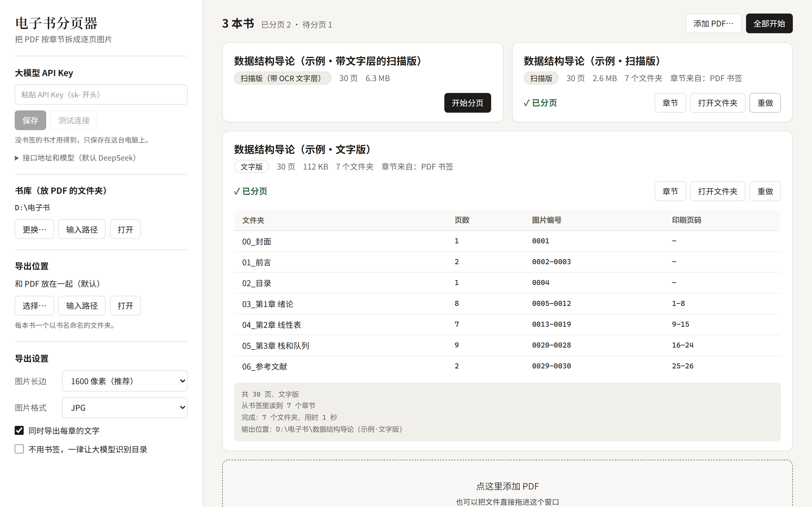

# PDF 电子书分页器

[](https://github.com/XuYui/pdf-book-splitter/actions/workflows/tests.yml)
[](LICENSE)

把 PDF 电子书拆成逐页图片，并按章节放进不同的文件夹。和 AI 一起读书时，只把要问的那一章、那几页交给它，不用上传整本书。

*Split a PDF e-book into per-page images grouped into one folder per chapter, so you can hand an AI just the pages you are asking about. Runs locally with a small web UI; the interface is in Chinese.*



## 为什么需要它

把整本电子书丢给 AI 有三个问题：文件太大，上传慢，还常常超过大小或页数上限；内容太多，占满上下文；无关的内容会分散模型的注意力，回答反而变差。按章节拆开以后，问哪一章就传哪一章。

## 功能

- **自动判断文字版还是扫描版**，两种书走各自的流程（见[它是怎么分章的](#它是怎么分章的)）。
- **三种找章节的办法**：PDF 自带书签时直接用书签，不联网；没有书签时请大模型读目录，再逐章核对起始页。
- **文件名带两种页码**：`0071_p53.jpg` 表示 PDF 的第 71 页、书上印的第 53 页，按书里的页码也能找到图。
- **有文字层的书顺便导出每章的纯文字**，比图片省得多。
- **网页界面**：在页面上填 API Key、选书库和导出位置，批量处理，看进度。
- **只在本机运行**：服务只监听 `127.0.0.1`，书不会传到别处；只有需要识别目录时才把目录相关的页面发给你配置的大模型。

## 安装和启动

需要 Python 3.10 或更新的版本。在 Windows 11 上开发和测试；核心功能不依赖 Windows，但其他系统没有测过。

```bash
git clone https://github.com/XuYui/pdf-book-splitter.git
cd pdf-book-splitter
pip install -r requirements.txt
python app.py
```

Windows 上也可以直接双击 `启动分页器.bat`。启动后浏览器会打开 <http://127.0.0.1:8765>，用完关掉启动时弹出的窗口就退出了。

## 怎么用

1. **放书**：把 PDF 拖进页面，或点「添加 PDF」，或直接放进书库文件夹（默认是程序所在的文件夹，可以在左栏更换）。
2. **看类型**：每本书下面会标出「文字版」「扫描版」或「扫描版（带 OCR 文字层）」。
3. **分页**：点「开始分页」或「全部开始」。分好以后点「章节」看每个文件夹对应哪些页，点「打开文件夹」取图。

有书签的书到这里就完成了。没有书签的书需要先在左栏填一个大模型的 API Key，否则所有页面会放进同一个文件夹；填好后点「重做」即可。

图片默认导出到 PDF 旁边，也可以在左栏「导出位置」里指定别的文件夹。

## 导出的结构

```
计算机网络（第8版）/                    ← 书名（去掉了下载站加在文件名后面的尾巴）
├── 目录.md                           ← 每个文件夹、每个小节对应的图片编号
├── 00_封面/
│   └── 0001.jpg
├── 08_第1章 计算机网络和因特网/
│   ├── 0019_p1.jpg                   ← PDF 第 19 页，书上印的是第 1 页
│   ├── 0020_p2.jpg
│   ├── …
│   └── 本章文字.txt                   ← 这一章的纯文字（有文字层的书才有）
├── 09_第2章 应用层/
└── …
```

- 章节文件夹前面的序号保证它们按书的顺序排列。
- 没有书签、也没有配置大模型的书，所有图片放在 `全书/` 里。
- 靠大模型识别目录的书，第一章之前的页面（封面、前言、目录）合并在 `00_前置页/` 里。

## 它是怎么分章的

每本书先逐页检查，判断类型，然后分别处理：

| | 文字版 | 扫描版 |
|---|---|---|
| 怎么认出来 | 多数页面上有看得见的文字 | 多数页面整页是一张图；图下面垫着识别文字的算「带 OCR 文字层」 |
| 印刷页码 | 从页眉页脚的文字里读 | 有 OCR 文字层就从里面读，否则请大模型抽查十来页 |
| 有书签 | 用书签 | 用书签 |
| 没有书签 | 把前若干页的**文字**发给大模型读出目录，再在本地按大字标题核对每章的起始页 | 把前若干页的**图片**发给大模型识别目录，再把每章起始页前后几页的图片发给它核对 |
| 导出 | 逐页图片 + 每章文字 | 逐页图片（不放大到超过原图）；有 OCR 文字层时也导出文字 |

几种容易认错的情况做了处理：每页被加了一行水印文字的扫描书仍算扫描版；铺了整页底图的文字版仍算文字版；一页被切成几条图拼起来的扫描书仍算扫描版。

核对不上的章节不会被悄悄放过：它们按目录上的页码推算位置，并在界面和 `目录.md` 里标成「起始页未核对」。

## 关于大模型

- **什么时候用**：只有没有书签的书才会调用。
- **用哪家**：默认是 DeepSeek 的 `deepseek-flash`。任何兼容 OpenAI `chat/completions` 的接口都可以，在左栏「接口地址和模型」里改。扫描版要求模型支持图片输入；只支持文字的模型仍然可以处理文字版。
- **会发出去什么**：文字版发前 40 页提取出的文字；扫描版发前 40 页的图片、抽查的 12 页，以及每章起始页前后几页的图片。正文的其余部分不会发出去。
- **花多少**：一本 503 页的文字版教材实测用了约 2.8 万 tokens。扫描版一本书大约发一百来张图。
- **Key 存在哪**：明文保存在程序文件夹的 `config.json` 里，页面上只显示尾号。`config.json` 已经在 `.gitignore` 里，不会被提交。

## 命令行

不想开网页时可以直接用命令行，或者把 PDF 拖到 `拖入PDF开始分页.bat` 上：

```bash
python split_book.py 书.pdf 另一本.pdf --out D:\导出
```

| 参数 | 作用 |
|---|---|
| `--out 文件夹` | 导出到哪里，默认放在 PDF 旁边 |
| `--long-edge 1600` | 图片长边的像素数 |
| `--format jpg` | 图片格式：`jpg`、`png` 或 `webp` |
| `--quality 80` | `jpg`/`webp` 的质量 |
| `--no-text` | 不导出每章的文字 |
| `--no-bookmarks` | 忽略书签，改用大模型识别目录 |
| `--no-api` | 不调用大模型 |
| `--force` | 重做已经分过页的书 |

命令行从 `config.json`（可以照着 `config.example.json` 写）或环境变量 `DEEPSEEK_API_KEY` 读取 API Key。

## 设置项

网页上改的设置都保存在 `config.json` 里：

| 字段 | 默认值 | 含义 |
|---|---|---|
| `api_key` | 空 | 大模型的 API Key |
| `base_url` | `https://api.deepseek.com` | 接口地址 |
| `model` | `deepseek-flash` | 模型名称 |
| `extra_body` | 关闭思考模式 | 附加在每次请求里的参数，换别家模型时可以清空 |
| `toc_scan_pages` | `40` | 把前多少页交给大模型找目录 |
| `folder` | 空（程序所在的文件夹） | 书库 |
| `output` | 空（和 PDF 放在一起） | 导出位置 |
| `long_edge` / `format` / `quality` | `1600` / `jpg` / `80` | 图片的长边、格式、质量 |
| `export_text` | `true` | 是否导出每章的文字 |
| `ignore_bookmarks` | `false` | 不用书签，一律让大模型识别目录 |

## 测试

```bash
pip install -r requirements-dev.txt
python -m pytest
```

测试用 PyMuPDF 现造一本《示例图书》的各种版本（文字版、扫描版、带 OCR 文字层、带水印、带底图），大模型用假的，全程不联网。

## 已知的局限

- 文字版「读目录文字」的流程用 DeepSeek 在一本 503 页、8 章的教材上实测过，分出的章节起始页和书签完全一致。扫描版「看图识别目录」的流程目前只用模拟的模型回答测过，真实模型的准确度还没有验证。
- 目录要在书的前 40 页里（可以改 `toc_scan_pages`）。
- 不支持一页 PDF 上并排印着两页书的对开扫描件。
- 文件名清理后相同的两本 PDF 会共用一个导出文件夹。
- 正在处理的书不能中途取消，只能取消还在排队的。
- 只处理 PDF，不支持需要密码才能打开的文件。

请只处理你有权使用的电子书。

## 许可证

[AGPL-3.0](LICENSE)。本项目依赖 [PyMuPDF](https://github.com/pymupdf/PyMuPDF)，它以 AGPL-3.0 发布，所以本项目采用相同的许可证。
